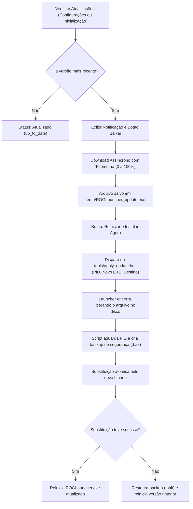

# Arquitetura e Funcionamento do Sistema de Atualização Automática

O **ROG Launcher** implementa um mecanismo de atualização atômico, assíncrono e seguro, projetado para permitir que o usuário receba novas versões sem perder suas configurações, listas de jogos ou histórico de downloads.

---

## 📡 1. Fonte e Endpoint de Versões

O launcher monitora o endpoint público oficial de lançamentos da API do GitHub:

```text
https://api.github.com/repos/castellorogerio/rog-launcher-releases/releases
```

* **Comunicação Segura**: Realizada via HTTPS com cabeçalho de User-Agent customizado (`ROGLauncher-Updater/1.0`).
* **Sem Necessidade de Autenticação**: O endpoint é totalmente público e compatível com taxa de requisição padrão, sem expor tokens ou segredos locais.

---

## 🔍 2. Ciclo de Vida da Atualização



---

## 🛡️ 3. Garantias de Segurança e Preservação de Dados

1. **Substituição Atômica com Rollback**:
   * O script `apply_update.bat` executa fora da memória do Python/Qt.
   * Se a substituição falhar por qualquer motivo (bloqueio de antivírus, falha de disco), o backup `ROGLauncher.exe.bak` é imediatamente restaurado, evitando que o usuário fique sem o launcher funcional.
2. **Preservação de Dados de Usuário**:
   * Arquivos de configuração (`config.json`), perfis (`stats.json`), bibliotecas (`rog_personal_library.json`) e pastas de downloads permanecem 100% preservados e intocados durante a atualização.
3. **Download Parcial ou Corrompido**:
   * O download é efetuado em diretório temporário (`temp/`). O executável em uso nunca é sobrescrito antes que o download termine integralmente (100%).
